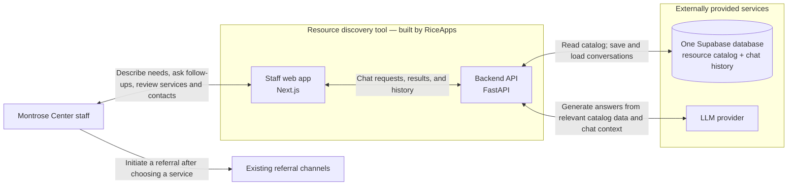
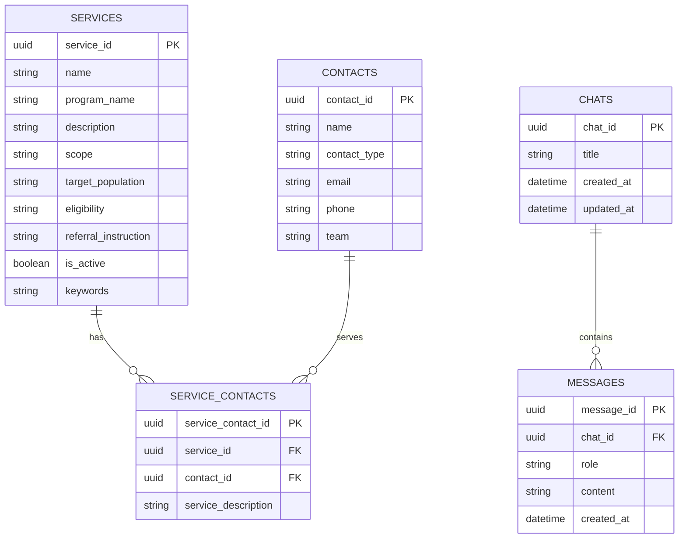

# Phase 1 architecture diagram

This is the **target architecture for Phase 1**, based on the [first coding sprint flow](first-coding-sprint.md) and the Phase 1 resource discovery roadmap. It is a design proposal, not a diagram of working code: the repository currently has a placeholder web page and chat method signatures, while only the API health endpoint is active.

## System overview

The web app and backend API are the system we build. Supabase hosts **one database** containing several related tables; the LLM is a separate provider. Internal and external *resources* are catalog entries in that database, not separate infrastructure providers. Referral messages continue through the staff's existing channels, outside this tool.

The backend is responsible for retrieving relevant services and their program information, carrying conversation context into follow-up answers, and returning specific recommendations with reasons and available referral contacts. It should say when no suitable resource is found or when contact details are missing. Staff choose the service and initiate the referral themselves. A full catalog, filters, named-resource search, ranking, and confidence scores are P1 extensions; the same system boundary supports them without implying they are part of the first sprint.

## Proposed Supabase data model

The schema below expands the single database in the overview. It adapts the supplied Services, People, Chat History, and Messages sketch. There is no `programs` table: each service stores its parent program's name directly, when applicable. The sketch's `Program_ID` is omitted because there is no local program record for it to identify. `contacts` covers either a person or a team.

`services.scope` distinguishes internal from external resources. `services.program_name` may be empty for an external resource without a Montrose Center parent program. `messages.role` is `user` or `assistant`, matching the current API types and serving the purpose of the sketch's `Is_Agent` field. The sketch's `Chat History.Person_ID` is deferred because the Phase 1 scaffold has no staff identity or authentication model; chats and messages can still preserve context within a conversation.

`SERVICE_CONTACTS` connects services to their referral contacts. For example, if one service accepts referrals through both a staff member and an intake team, it has two rows in this table, one for each contact. A contact can also serve multiple services. `service_description` records that contact's role for this particular service, and the `(service_id, contact_id)` pair should be unique.

In the diagram, **PK** means *primary key*: a value that uniquely identifies a row, such as `services.service_id`. **FK** means *foreign key*: a value that points to a row in another table. Here, `service_contacts.service_id` points to a service, and `service_contacts.contact_id` points to a contact.

## Planned API surface

The backend exposes chat operations to the web app. The first sprint already defines these method signatures and response shapes, but has not registered or implemented the chat routes.

| Operation | Purpose |
| --- | --- |
| `POST /chats`, `GET /chats` | Start a conversation or list saved conversations. |
| `GET /chats/{chat_id}`, `PATCH /chats/{chat_id}` | Read a conversation or update its title. |
| `POST /chats/{chat_id}/messages` | Ask a question or follow-up and receive the saved user and assistant messages. |

The Phase 1 response must also present the recommended service, parent program when applicable, reason for the match, referral instructions, and available contacts. The exact structured response contract for those details is still to be designed. Catalog browsing and filtering endpoints belong to P1. No endpoint sends a referral.
