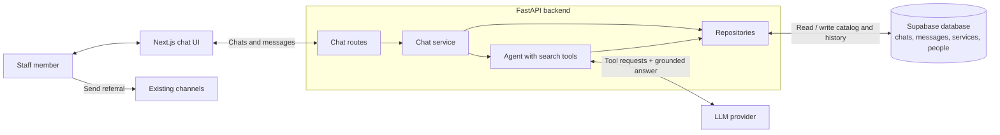
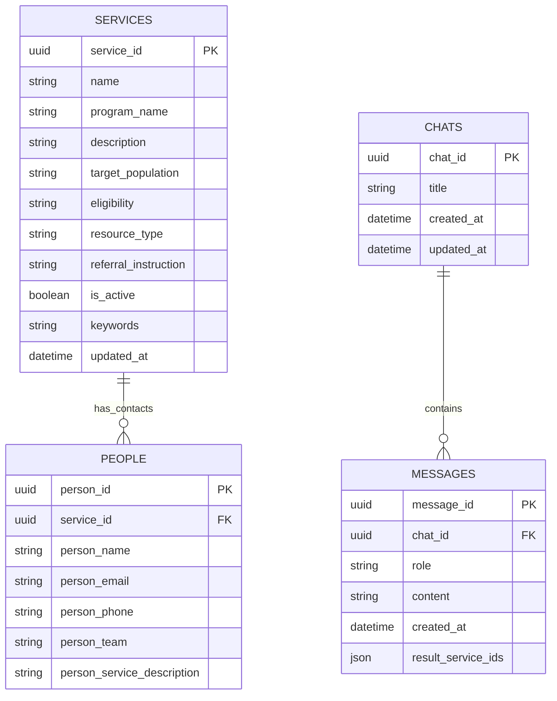

# Phase 1 architecture diagram

This diagram shows the **proposed Phase 1 architecture**. It follows the [first coding sprint flow](../docs/coding-sprint-10-24.md) and the resource discovery roadmap. The repository has a placeholder web page and chat method signatures. Only the API health endpoint is active.

The [search and agent flows](search-and-agent-flow.md) show how a prompt becomes ranked service results and how the agent uses backend tools.

## System overview



The system has a web app and backend API. Supabase stores the catalog and chat history in one database. An LLM provider supplies generated answers. Staff send referrals through existing channels.

The backend retrieves services and program details. It uses conversation history for follow-ups and returns recommendations with reasons and available contacts. It should state when no suitable service appears or contact details are missing. Staff choose a service and make the referral. Catalog browsing, filters, and displayed scores are possible P1 extensions.

## Proposed Supabase data model

This schema adapts the supplied Services, People, Chat History, and Messages sketch. Each service stores its parent program's name when applicable. There is no `programs` table, so the design omits `Program_ID`.



`services.keywords` lists terms for each service. `program_name`, `target_population`, `eligibility`, and `referral_instruction` may be null. `resource_type` is `internal` or `external`. It does not prove eligibility. Add `resource_type`, `eligibility`, and `updated_at` when creating the Supabase catalog to support the planned API.

`messages.role` is `user` or `assistant`, replacing the sketch's `Is_Agent`. Assistant replies may store ordered `result_service_ids` for follow-ups such as “the second one.” Current API types do not include that field. Defer `Chat History.Person_ID` until staff identity is designed. `PEOPLE` stores referral contacts, not staff identities.

The original sketch lacked separate eligibility and scope fields. The next-sprint JSON catalog adds them. Do not infer eligibility from a description or target population when the value is unknown.

Each `PEOPLE` row links to one service through `service_id`. A service can have several contacts. `person_service_description` gives the contact's role. The supplied schema does not need the earlier `SERVICE_CONTACTS` join table. Add a join table later if one stored person must link to several services.

**PK** means *primary key*, a unique row ID. **FK** means *foreign key*, an ID that points to another table. `people.service_id` points to a service, and `messages.chat_id` points to a chat. The design omits `SERVICES.person_id`. That field would limit a service to one contact and duplicate the link in `PEOPLE.service_id`.

## API work and proposed contract

The same endpoint details are available in the standalone [API contract](api-contract.md).

The browser sends JSON to FastAPI. The code defines chat route signatures and basic `Chat`, `Message`, and `SendMessageResponse` types. Those routes are not registered or implemented. The service routes and structured recommendation fields below are **proposals** for the next sprint and Phase 1. The supplied API examples informed the endpoint layout. Their `/auth` and document-upload routes do not belong to this design.

### Shared conventions

- Requests use `Content-Type: application/json`, and successful responses use JSON. Timestamps are UTC ISO 8601 strings. IDs are UUID strings. Current Python models type chat and message IDs as `str`. Rejecting malformed UUID path IDs requires a schema change.
- Path IDs identify chats or services, not staff members. A multiuser pilot needs an approved chat access model. No authentication route or bearer-token format exists yet.
- FastAPI returns `422 Unprocessable Entity` when a request fails declared schema validation. The proposed API should return `400 Bad Request` for valid JSON with invalid values, such as blank content. This needs explicit value checks.
- Application errors should use one response envelope. This is a **proposal**. Current `HTTPException` responses use `{"detail": "..."}`.

```json
{
  "error": {
    "code": "chat_not_found",
    "message": "Chat not found."
  }
}
```

| Status | Meaning and use |
| --- | --- |
| `200 OK` | Read, update, search, or send succeeded. An empty service search and a no-match answer are still successful results. |
| `201 Created` | The API created a chat. The body contains the new `Chat`. The `Location: /chats/{chat_id}` header is recommended. |
| `400 Bad Request` | A well-formed request contains an invalid value, such as blank content or an out-of-range limit. |
| `404 Not Found` | The requested chat or service does not exist or is unavailable to the caller. |
| `422 Unprocessable Entity` | FastAPI cannot validate the JSON body, path ID, or query parameter against the declared schema. |
| `502 Bad Gateway` | The model provider failed during message generation. The API should not save a partial exchange. |
| `503 Service Unavailable` | A required backend dependency is unavailable. The scaffold already returns 503 when Supabase is not configured. |

In the examples, `Chat` has `id`, `title`, `created_at`, `updated_at`, and `messages`. `ChatSummary` omits `messages`. A `Message` has `id`, `chat_id`, `role`, `content`, and `created_at`. `role` is `user` or `assistant`. Responses use `application/json` unless noted.

### `POST /chats` — create a conversation

Creates an empty conversation. An omitted title uses the first-sprint default `"New chat"`. An explicitly blank title should return 400 after value validation is added.

**Request body**

```json
{"title": "Housing options"}
```

**201 response body**

```json
{
  "id": "bde8a7a0-4a3c-4e4e-9c93-62a53d45ae01",
  "title": "Housing options",
  "created_at": "2026-10-31T16:00:00Z",
  "updated_at": "2026-10-31T16:00:00Z",
  "messages": []
}
```

Other responses: `400` for an invalid title, `422` for an invalid JSON body, and `503` when chat storage is unavailable.

### `GET /chats` — list conversations

Returns `200` with `ChatSummary` objects, ordered by most recent update. An account with no chats receives `[]`. Define authentication and ownership filters before a multiuser pilot.

```json
[
  {
    "id": "bde8a7a0-4a3c-4e4e-9c93-62a53d45ae01",
    "title": "Housing options",
    "created_at": "2026-10-31T16:00:00Z",
    "updated_at": "2026-10-31T16:00:00Z"
  }
]
```

Return `503` if chat storage is unavailable. Decide pagination later. The current first-sprint method returns a list.

### `GET /chats/{chat_id}` — read a conversation

Returns `200` with a `Chat` and its messages, oldest first. The response uses the `POST /chats` fields and adds saved `Message` objects. Return `404` for an unknown or inaccessible chat, `422` for an invalid ID, or `503` if storage is unavailable.

### `PATCH /chats/{chat_id}` — rename a conversation

Accepts `{"title": "Updated title"}` and returns the updated `Chat` with its messages. The title must be nonblank. Return `400` for a blank title, `404` for an unknown or inaccessible chat, `422` for an invalid body or ID, or `503` if storage is unavailable.

### `POST /chats/{chat_id}/messages` — ask or follow up

Accepts a nonblank question. The backend loads prior messages and ordered service IDs. It calls the bounded agent and catalog lookup, then saves both messages. The **first-sprint response** has only `user_message` and `assistant_message`. Phase 1 should add `outcome` and `recommendations` to separate catalog facts from generated explanation.

**Request body**

```json
{"content": "What housing resources might fit?"}
```

**Proposed 200 response body** (fictional IDs and facts)

```json
{
  "user_message": {
    "id": "52197569-74f3-49dc-a31d-e34051e329a3",
    "chat_id": "bde8a7a0-4a3c-4e4e-9c93-62a53d45ae01",
    "role": "user",
    "content": "What housing resources might fit?",
    "created_at": "2026-10-31T16:02:00Z"
  },
  "assistant_message": {
    "id": "761e4783-d4dc-46fa-83e0-96926bc82f31",
    "chat_id": "bde8a7a0-4a3c-4e4e-9c93-62a53d45ae01",
    "role": "assistant",
    "content": "This service may be relevant. Check the current details before making a referral.",
    "created_at": "2026-10-31T16:02:01Z"
  },
  "outcome": "matches",
  "recommendations": [
    {
      "service_id": "7f043129-46cb-4a80-9aa8-6b79311cd99a",
      "name": "Example Housing Navigation",
      "resource_type": "internal",
      "program_name": "Example Support Program",
      "description": "Fictional housing navigation service.",
      "reason": "The catalog description mentions housing navigation.",
      "gaps": ["Eligibility has not been recorded."]
    }
  ]
}
```

`outcome` is `matches`, `no_match`, or `clarification`. For the latter two states, `recommendations` is `[]`. The assistant message explains the gap or asks which service staff mean. Missing contacts and instructions are **not** request errors. The detail response returns null fields or an empty contacts array. The backend should build facts from retrieved records, check each ID, and save result order for later references.

Other responses: `400` for blank content, `404` for an unknown or inaccessible chat, and `422` for an invalid body or ID. Model failure returns `502`. Unavailable storage or catalog returns `503`. A no-match answer returns `200`.

### `GET /services?q={text}` — search the catalog

The next-sprint JSON catalog returns ordered summaries of **active** services. `q` is required and nonblank. The proposed optional `limit` defaults to 10 and accepts 1–20. A search with no matches returns `[]`. Search uses names, keywords, and descriptions. Missing data cannot verify eligibility.

```json
[
  {
    "service_id": "7f043129-46cb-4a80-9aa8-6b79311cd99a",
    "name": "Example Housing Navigation",
    "program_name": "Example Support Program",
    "resource_type": "internal",
    "description": "Fictional housing navigation service."
  }
]
```

Return `400` for a blank query or invalid limit, `422` for an invalid query type, or `503` if the catalog is unavailable. The repository has no service route yet.

### `GET /services/{service_id}` — inspect current service details

Returns `200` with the current catalog record and contacts. Service fields include `service_id`, `name`, `description`, `keywords`, `is_active`, `resource_type`, `program_name`, `target_population`, `eligibility`, `referral_instruction`, and `contacts`. The last four descriptive fields may be null. A contact has `person_id` and nullable name, email, phone, team, and service-description fields. Use JSON `null` for unknown values and `"contacts": []` when no contact exists. Add `updated_at` in Phase 1 if the source provides it.

```json
{
  "service_id": "7f043129-46cb-4a80-9aa8-6b79311cd99a",
  "name": "Example Housing Navigation",
  "description": "Fictional housing navigation service.",
  "keywords": "housing, navigation",
  "is_active": true,
  "resource_type": "internal",
  "program_name": "Example Support Program",
  "target_population": null,
  "eligibility": null,
  "referral_instruction": null,
  "contacts": [
    {
      "person_id": "a2e44922-462d-4392-8457-5a1b91912111",
      "person_name": "Example Contact",
      "person_email": null,
      "person_phone": null,
      "person_team": "Housing Team",
      "person_service_description": "Referral contact"
    }
  ]
}
```

Return `404` for an unknown or inactive service, `422` for an invalid ID, or `503` if the catalog is unavailable. Show “not recorded” for missing facts. This endpoint does not send referrals.

### Implementation order

First, implement the five scaffolded chat operations and keep their response fields. Next, add two read-only service routes over the fictional catalog. For Phase 1, add structured recommendations and ordered result IDs to responses and storage. The error envelope, explicit 400 checks, `limit`, and `updated_at` need schema, route, and frontend work. They describe planned behavior. No route uploads arbitrary documents or sends referrals.
