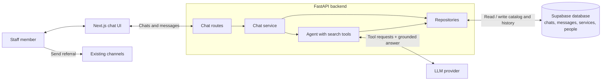
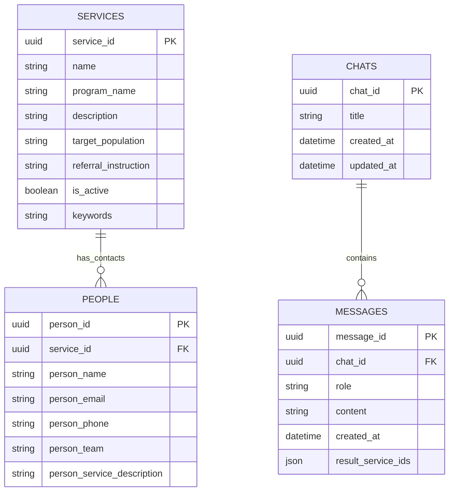

# Phase 1 architecture diagram

This is the **target architecture for Phase 1**, based on the [first coding sprint flow](first-coding-sprint.md) and the Phase 1 resource discovery roadmap. It is a design proposal, not a diagram of working code: the repository currently has a placeholder web page and chat method signatures, while only the API health endpoint is active.

The [search and agent flows](search-and-agent-flow.md) show how a prompt becomes ranked service results and how the agent uses backend tools.

## System overview

The web app and backend API are the system we build. Supabase holds the catalog and chat history in one database; the LLM is a separate provider. Referral messages continue through the staff's existing channels, outside this tool.

The backend is responsible for retrieving relevant services and their program information, carrying conversation context into follow-up answers, and returning specific recommendations with reasons and available referral contacts. It should say when no suitable resource is found or when contact details are missing. Staff choose the service and initiate the referral themselves. Full-catalog browsing, catalog filters, and displayed ranking or confidence scores are P1 extensions; the same system boundary supports them without implying they are part of the first sprint.

## Proposed Supabase data model

The schema below adapts the supplied Services, People, Chat History, and Messages sketch. There is no `programs` table: each service stores its parent program's name directly, when applicable. The sketch's `Program_ID` is omitted because there is no local program record for it to identify.

`services.keywords` is a list of terms on each service. `services.program_name` may be empty for an external resource without a Montrose Center parent program. `messages.role` is `user` or `assistant`, matching the current API types and serving the purpose of the sketch's `Is_Agent` field. `messages.result_service_ids` is an optional ordered list on assistant replies, proposed for follow-ups such as “the second one”; it is not in the current API types. The sketch's `Chat History.Person_ID` is deferred because `PEOPLE` holds referral contacts, not staff identities; chats and messages can still preserve context within a conversation.

The supplied service fields do not separately record eligibility or whether a service is internal or external. Search can use the description and target population, but should not claim to have verified those missing details.

Each `PEOPLE` row points to one service through `service_id`, so a service can have multiple contacts. `person_service_description` describes that person's role for the service. The earlier `SERVICE_CONTACTS` table modeled a many-to-many relationship; it is unnecessary for the supplied schema. If the same person must be stored once and linked to several services later, a join table would then be useful.

In the diagram, **PK** means *primary key*: a value that uniquely identifies a row, such as `services.service_id`. **FK** means *foreign key*: a value that points to another table. Here, `people.service_id` points to a service, and `messages.chat_id` points to a chat. `SERVICES.person_id` is omitted because it would allow only one contact per service and duplicate the relationship already recorded by `PEOPLE.service_id`.

## Planned API surface

The backend exposes chat operations to the web app. The first sprint already defines these method signatures and response shapes, but has not registered or implemented the chat routes.

| Operation | Purpose |
| --- | --- |
| `POST /chats`, `GET /chats` | Start a conversation or list saved conversations. |
| `GET /chats/{chat_id}`, `PATCH /chats/{chat_id}` | Read a conversation or update its title. |
| `POST /chats/{chat_id}/messages` | Ask a question or follow-up and receive the saved user and assistant messages. |

The Phase 1 response must also present the recommended service, parent program when applicable, reason for the match, referral instructions, and available contacts. The exact structured response contract for those details is still to be designed. Catalog browsing and filtering endpoints belong to P1. No endpoint sends a referral.
