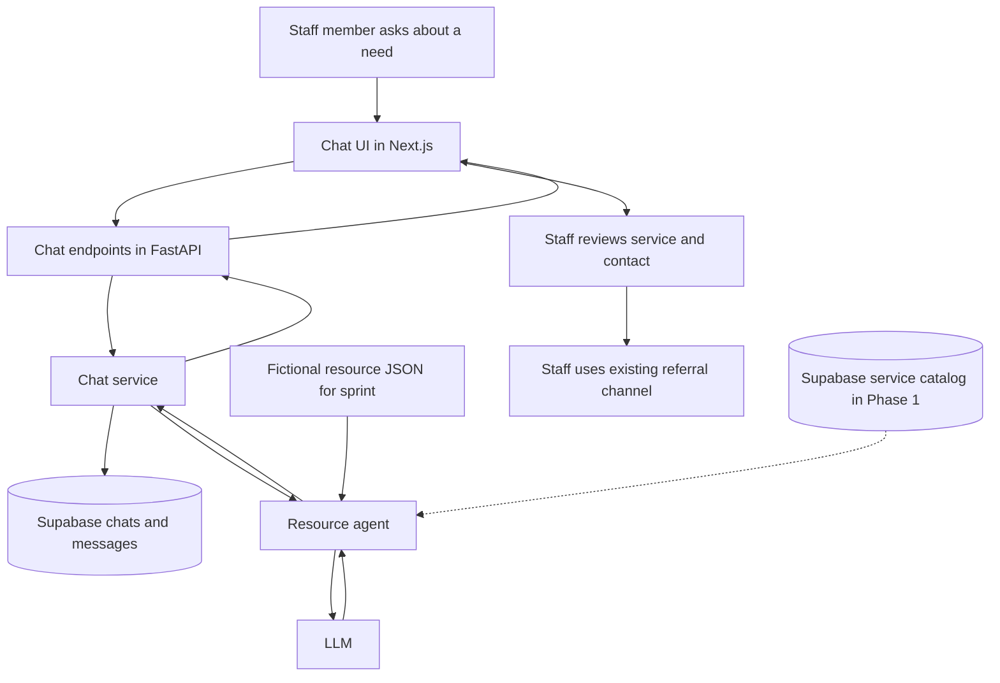

# First coding sprint

## Purpose

Build the foundation for a staff chat interface that will eventually help Montrose Center staff discover services and find referral contacts. This sprint uses a small **fictional** resource file. It does not yet implement the full Phase 1 search experience.

## Planned flow

The diagram shows the intended flow, **not current behavior**. The code currently contains task signatures; the chat UI, chat endpoints, persistence, and model call still need implementation. In Phase 1, the resource catalog should provide specific services, their parent programs, eligibility details, referral instructions, and contacts. The staff member decides which resource to use and initiates any referral outside this tool.

## Starter tasks

| # | Task | Sprint work | Connection to Phase 1 |
| --- | --- | --- | --- |
| 1 | Message component | Render user and assistant messages. | Presents recommendations, explanations, and contact details clearly. |
| 2 | Sidebar component | List conversations and select or start a chat. | Helps staff return to a resource search and compare options. |
| 3 | Input component | Let staff send a question or follow-up. | Supports natural-language needs and refinements. |
| 4 | Chat API | Define frontend requests and backend endpoints for chats and messages. | Connects the staff interface to search and response logic. |
| 5 | Chat logic | Coordinate history, agent calls, and responses. | Provides the flow needed for follow-up questions. |
| 6 | Persistence | Save chats and messages in Supabase. | Supports conversation continuity for follow-up questions. |
| 7 | Simple agent | Build a system prompt with fictional resources and call an LLM. | Tests the answer format before connecting the real service catalog. |

The starting signatures are in `apps/web/src/components/`, `apps/web/src/lib/api.ts`, and `apps/api/app/{routers,services,repositories}/`. Request and response shapes are in `apps/api/app/schemas/chats.py`.

### Router dependency injection

Each chat handler accepts `service: ChatServiceDep`, defined in `apps/api/app/dependencies.py`. Once Task 4 registers the routes, FastAPI will call `get_chat_service`, resolving its repository and agent dependencies first. The handler can then delegate to the supplied service (for example, `service.create_chat(payload.title)`). The service and repository use ordinary constructor arguments and do not depend on FastAPI.

These providers create new instances per request; FastAPI reuses a provider's result within that request by default. They are not application-wide singletons. The Supabase provider reads the exported backend environment variables only when needed and closes its HTTP client after the request. Tests can replace `get_chat_service` or any lower-level provider with `app.dependency_overrides` without contacting Supabase or an LLM. The chat routes and business methods remain sprint TODOs.

## Sprint completion target

A developer should be able to start a chat, ask about the fictional resources, receive a reply based on that data, ask a follow-up, and reopen the conversation after a refresh. The demo should show when the fictional data does not contain an answer. 
