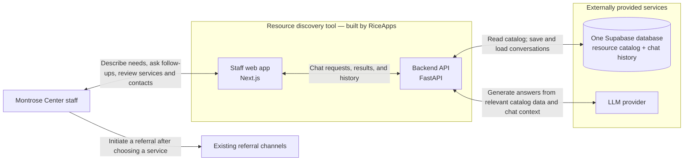
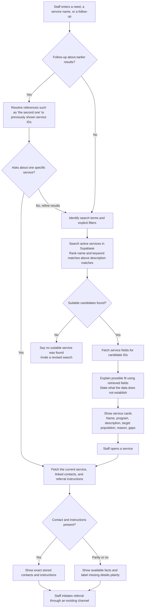
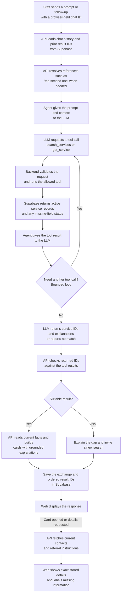
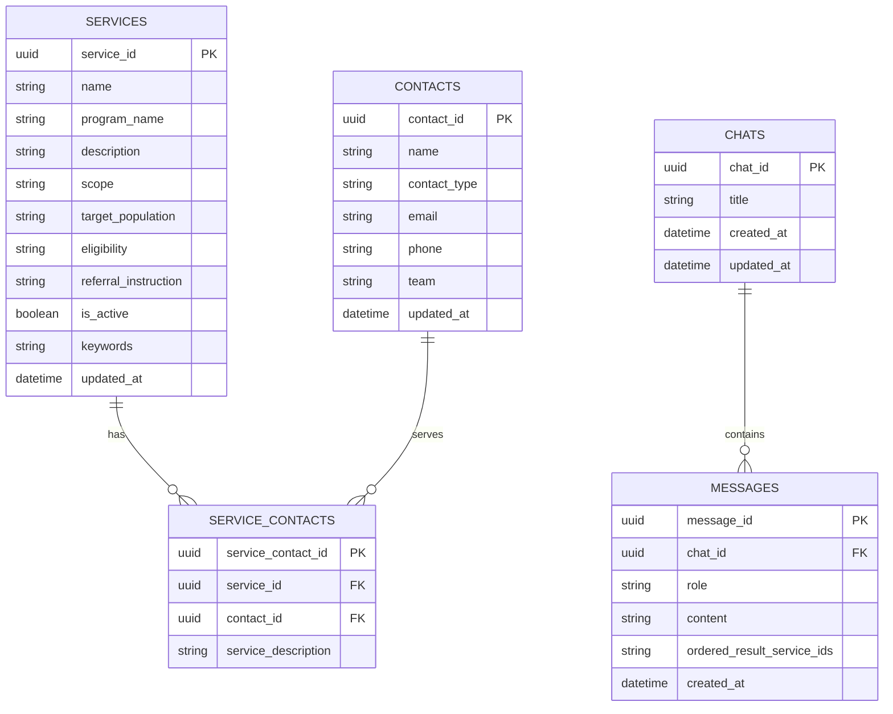

# Montrose Center Resource Discovery: Technical Design

**Status:** Proposed for review  
**Date:** October 30, 2026  
**Audience:** Montrose Center and RiceApps product and engineering teams  
**Basis:** Product Roadmap last edited October 11, 2026, and the Montrose Center repository  
**Implementation state:** Proposed Phase 1 architecture; the repository is a first-sprint scaffold

## Summary

The first release should help Montrose Center staff describe a client need in natural language, compare specific internal and external services, and find the current contact for a selected service. Staff remain responsible for choosing a service and making the referral through their existing channels. The release should use a curated, static catalog and return facts from that catalog, while allowing the language model to interpret questions and explain possible fit. It must say when a match, eligibility fact, or contact is unknown.

This design turns the roadmap's Phase 1 into an implementable system and identifies where the existing first-sprint scaffold must grow. The architecture and search diagrams in the repository are proposals, not deployed behavior.

## Problem and desired outcome

Staff currently rely on personal knowledge, a group chat, and exact-keyword search to find services and referral contacts. Knowledge is uneven across programs, and newer staff may not know the right service or search term. A service can also be known while its current contact or referral instructions are unclear. This slows the handoff and can hide an appropriate internal or external option.

The system should turn a plain-language need into a short, inspectable list of **specific services**, explain why each may fit using catalog facts, expose uncertainty, and show the latest recorded contact when staff select a service. Success means staff can discover an appropriate option and know whom to contact faster than with the current process. Staff make the final choice and referral; this system does not determine eligibility or transmit a client file.

## Users and key tasks

Staff who know their own program well but not the full Center catalog need to discover other options. New staff need a way to ask in ordinary language without knowing program names. For either group, a successful session ends with a short list of plausible services, the reason each might fit, any important uncertainty, and a verified contact for the service they select.

The primary journey is: enter a need and permitted, nonidentifying context; review service-level results; ask a follow-up or refine the search; open a service to inspect current facts and contacts; then use an existing channel to make a referral. The system does not decide eligibility, send client files, or contact a client in Phase 1.

## Scope and phase boundaries

| Area | Phase 1 design | Later phase |
| --- | --- | --- |
| Search | Natural-language questions and follow-ups over active internal and external services | Improve retrieval using staff feedback and, if needed, hybrid search |
| Results | Service-level recommendations with parent program, grounded reason, and uncertainty | Outcome-aware ranking after referral outcomes are available |
| Referral help | Current person or team and contact method; show any cataloged instructions without promising a complete intake checklist | Collect service-specific referral requirements in Phase 2; Teams sending in Phase 3 |
| Catalog | Curated, static dataset loaded by the project team | Direct browsing, admin editing, deactivation, and prompt search updates in Phase 2 |
| History | Conversation continuity for follow-up questions | Usage and referral outcome workflows after privacy and identity decisions |

The roadmap puts contact lookup in Phase 1 and complete referral requirements in Phase 2. The Phase 1 catalog may contain a short instruction when known, but the product must label incomplete guidance and must not imply that it has collected every required client detail. No client-identifying information is needed for discovery.

The earlier architecture sketch calls full-catalog browsing and displayed ranking or confidence scores possible Phase 1 extensions. This consolidated Phase 1 design commits to conversational search and service detail; direct browsing and admin editing are later work, and scores require a staff-validated meaning before display.

## Staff experience

The web app should provide a chat input, message thread, and conversation list. A short instruction near the input should tell staff to describe needs without names, dates of birth, record numbers, diagnoses, clinical notes, or other identifying information. The response should present a concise answer followed by structured service cards. Each card should show service name, internal or external scope, parent program if applicable, a brief description, why it may fit, and any eligibility or information gap. Contacts belong in the detail view so the staff member can inspect the latest record before acting.

When a staff member asks “Who handles referrals for the second one?”, the app should resolve “second one” against the ordered service IDs from the prior answer, fetch that service again, and show its stored contact. If the reference is ambiguous, ask which service they mean. If no suitable resource is found, say so clearly and invite a revised search. If a service lacks a contact or referral instruction, show “not recorded” and do not invent one.

The UI should distinguish catalog facts from generated explanation. It should avoid ranking percentages or confidence scores until they have a validated meaning for staff. A staff member should always be able to inspect the service record behind a recommendation.

## System design

The proposed system has a Next.js staff web app, a FastAPI backend, one Supabase database for the catalog and conversation history, and an LLM provider for interpreting questions and explaining retrieved results. The backend is the sole component that reads the database and calls the model. The browser calls the backend; it never receives a Supabase secret key. The model cannot query the database directly or call arbitrary tools.

### System boundary

Supabase hosts one database with related catalog and conversation tables. Internal and external services are **records**, not separate infrastructure providers. Referral communication stays in staff's existing channels. The system boundary supports later browsing, editing, and filtering, but those features are outside the Phase 1 scope in this design.

For each question, the API loads the conversation and prior ordered result IDs, interprets the current request, retrieves active service candidates, and fetches the records needed for an answer. The model may choose only allowlisted operations such as `search_services` and `get_service`; the backend validates their arguments and caps tool calls. It verifies every returned service ID against retrieved records, then builds the response's factual fields from those records. Opening a service fetches current details and contacts again. The API stores the question, answer, and ordered result IDs for later follow-ups.

Initial retrieval should use ranked full-text search on name, keywords, and description. Exact name matches should have priority. Explicit constraints such as internal versus external scope or age range should filter only when the catalog has a reliable field for them. A natural-language layer can reformulate the query and explain results, but it must not silently broaden a hard constraint. Evaluate this baseline with real, deidentified staff questions before adding embeddings or hybrid retrieval.

### Why a relational database

Service information has relationships that must remain consistent: one service can have several referral contacts, and one contact can serve several services. Chats have ordered messages, while a message may need to retain the ordered service IDs displayed to staff. A relational database provides stable IDs, foreign keys, uniqueness constraints, and transactional updates for those links. It also lets the backend query only active services, fetch current contacts when a card opens, and preserve conversation context after refresh. A static JSON file is useful for the first sprint but does not give the pilot a reliable shared catalog or durable multiuser history.

One Supabase database is sufficient for Phase 1. Keep catalog and chat data in separate tables with backend-only access; there is no need for a database per program or provider. `program_name` is stored on each service because Phase 1 uses a curated, static catalog and does not need a separate program lifecycle. Validate names during import to avoid spelling drift. If program ownership or editing becomes independent later, normalize programs into their own table. The database is the source of facts; the model's output is never the source of a contact, eligibility rule, or referral instruction.

### Why an agent

Staff express needs in varied language, ask follow-ups, and refer to earlier results by position or description. A bounded agent can interpret those requests, choose a catalog lookup, and explain possible fit in ordinary language. It is useful for mapping a conversational request to structured search and for combining retrieved facts into a readable response. It is **not** needed to store facts or to make the referral decision. An exact service-name lookup may bypass the model entirely.

The agent can request only backend-allowlisted `search_services` and `get_service` operations. The API validates arguments, caps the number of calls, resolves references against previously displayed service IDs, and checks every returned ID against retrieved records. It fills factual response fields from the database. This keeps the model from inventing a service, contact, or instruction and gives the API a controlled fallback when the model fails.

### How search works

1. The API loads the chat and the ordered IDs from the last relevant answer. It resolves a specific reference such as “the second one” before searching again; ambiguous references produce a clarification request.
2. For a new or refined need, the API derives search terms and explicit constraints. The agent may reformulate a query, but a stated hard constraint must remain intact.
3. Supabase searches **active** services using ranked full-text matches across `name`, `keywords`, and `description`, with known or exact names ranked highest. Scope and population constraints narrow results only when the catalog has reliable fields for them. An unknown value stays unknown; it is not treated as proof of eligibility.
4. The backend fetches complete service records for candidate IDs. The agent may explain possible fit and gaps, but the API validates its IDs and builds service fields from retrieved rows. It returns a no-match state if no suitable candidate survives.
5. The API saves the user message, assistant response, and ordered result IDs. Opening a card fetches the current service, linked contacts, and referral instruction again, so staff see the latest stored detail.

Search ranking is an internal retrieval aid, not a displayed confidence or eligibility score. Evaluate full-text search against deidentified staff questions before adding embeddings or hybrid retrieval. Supabase documents [ranked full-text search](https://supabase.com/docs/guides/database/full-text-search) and [hybrid search](https://supabase.com/docs/guides/ai/hybrid-search); the latter is a later option if the baseline misses relevant services.

#### Resource search and referral lookup

#### Agent orchestration

The browser-held chat ID identifies a prototype conversation; it is not a staff identity or a contact ID. Production access must bind chats to an approved staff access boundary.

## Proposed data model

| Entity | Key fields | Purpose |
| --- | --- | --- |
| Service | ID, name, program name, scope, description, target population, eligibility, keywords, referral instruction, active flag, updated time | Searchable unit and source of service facts |
| Contact | ID, name, person or team type, role or team, email, phone, updated time | Reusable referral point of contact |
| Service contact | Service ID, contact ID, role for this service | Supports multiple contacts per service and contacts shared across services |
| Chat | ID, title, created and updated times, staff owner when identity exists | Conversation container |
| Message | ID, chat ID, role, content, ordered result service IDs, created time | Conversation continuity and reference resolution |

**PK** identifies a row; **FK** points to another table's row. `service_contacts` implements the many-to-many service/contact link, including the contact's role for that service in `service_description`. Enforce a unique `(service_id, contact_id)` pair. `contacts` can represent a person or a team. `services.scope` distinguishes internal and external resources. `messages.role` is `user` or `assistant`, which replaces the earlier sketch's `Is_Agent` field. Ordered result IDs are a proposed addition to assistant messages; their exact storage type remains an implementation choice. The earlier sketch's `Program_ID` is omitted because there is no programs table, and `Chat History.Person_ID` is deferred until staff identity is designed.

The repository's proposed schema stores `program_name` on each service rather than maintaining a separate programs table. That is sufficient for the static Phase 1 catalog but can create inconsistent names; validate program names during import. External services may have no Montrose parent program. A unique service-contact pair prevents duplicate links. Deactivated services should disappear from new search results, while historical messages can still retain the text staff saw at the time.

The first-sprint fictional JSON contains only two example records and does not populate the proposed schema. Before a real pilot, Montrose Center must provide an approved catalog with service-level descriptions, scope, population, eligibility or unknown status, current contacts, and a named maintainer for each record. The import should reject incomplete identifiers and log records with missing contact information for review.

## API contract and implementation path

The existing scaffold defines chat models and method signatures for creating, listing, reading, and renaming chats and for sending a message. Its router has no registered chat endpoints and its service, repository, and agent methods are TODOs. The first sprint should implement those methods against fictional data, including saved conversations and a clear no-answer case, before connecting the real catalog.

For the Phase 1 response, extend the current `SendMessageResponse` with structured recommendations rather than putting all service facts in assistant prose. Each recommendation should include a service ID, name, scope, parent program, reason, and explicit gaps. A service detail endpoint should return the latest catalog fields, linked contacts, and a `last_updated` value. The API should return distinct states for no match, missing contact, ambiguous follow-up, invalid input, and upstream model failure. It should never return a fabricated recommendation when retrieval fails.

Suggested endpoints are the scaffolded `POST /chats`, `GET /chats`, `GET /chats/{id}`, `PATCH /chats/{id}`, and `POST /chats/{id}/messages`, plus `GET /services/{id}` for fresh details. The exact JSON schema, pagination, and error codes should be fixed before frontend and backend work split. Full catalog browsing and admin write endpoints remain outside Phase 1.

## Quality and rollout

Evaluate with a small set of deidentified questions from staff across programs. The set should include known service names, descriptions in staff language, internal and external requests, explicit constraints, follow-ups, no-match cases, and records with missing contacts. Review whether the right service appears, whether the explanation cites catalog facts, and whether contacts match the current record. Measure response time and task completion time against the current search and group-chat process. Set release thresholds with Montrose Center after a baseline is recorded; the roadmap has not yet supplied targets or a latency budget.

Roll out first with the fictional-data sprint demo, then a vetted catalog in a limited staff pilot. Have service owners confirm sample records and contacts before the pilot. Collect corrections from staff through a defined channel; because Phase 1 is static, a project maintainer applies catalog updates and republishes the search data. A pilot review should decide which Phase 2 editing and referral-checklist features solve actual observed friction.

### Phase 1 acceptance checks

- A staff member can ask a question in ordinary language, receive service-level results from active catalog records, and refine the request in the same conversation.
- A follow-up that names or references a prior result resolves to the correct service, or asks for clarification when the reference is ambiguous.
- Every displayed service fact and contact matches a stored record; opening a card refreshes the detail. Missing facts are labeled, and a no-match query produces no fabricated result.
- A chat can be reopened after a refresh in the approved pilot access model. Unauthorized access to another staff member's history is denied.
- The team reviews a deidentified evaluation set with Montrose Center staff and records relevance, factual accuracy, task time, response time, and model cost against agreed release thresholds.

## Risks and decisions for review

1. **Catalog accuracy.** Search quality cannot exceed the service data. Decide who approves initial records, how often contacts are checked, and how staff report stale details.
2. **Referral meaning.** The roadmap defines a referral as handing a client file to another staff member. Confirm whether the product should eventually help connect the client directly to the new resource; that changes workflow and privacy requirements.
3. **Identity and retention.** Decide how staff sign in, who may view saved chats, and how long nonidentifying conversations are kept before a real pilot.
4. **Success criteria.** Agree on what makes a good match, what task-time improvement matters, and an acceptable response time and model cost.
5. **Phase 1 guidance.** Confirm the minimum contact fields and whether a brief referral instruction is useful in the first release despite the complete requirements workflow being Phase 2.
6. **Later priorities.** Revisit the relative value of referral outcomes, Teams integration, a broader knowledge repository, and a public client tool after Phase 1 feedback.

## Repository references

This design consolidates the repository README, `design/first-coding-sprint.md`, `design/architecture_diagram.md`, `design/search-and-agent-flow.md`, and the current `apps/api` and `apps/web` scaffold. The original Word document contained the earlier `product-design.md` narrative without embedded charts; the updated Word document includes the diagrams above. The roadmap supplied by the product team is the source for delivery phases, intended outcomes, and open product questions.
