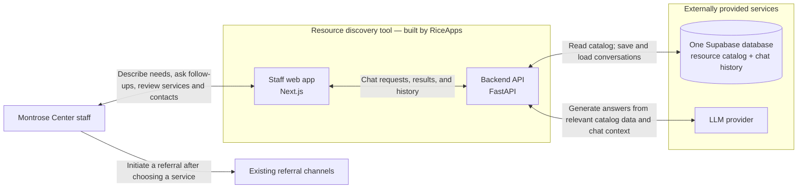
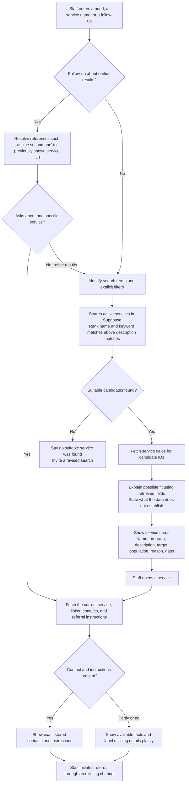
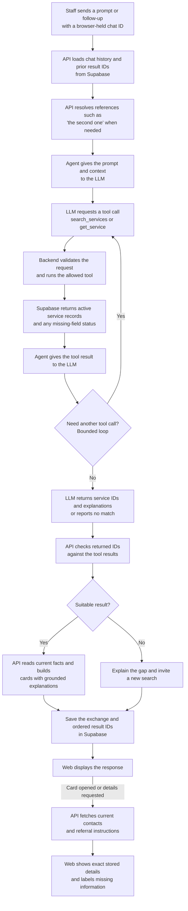
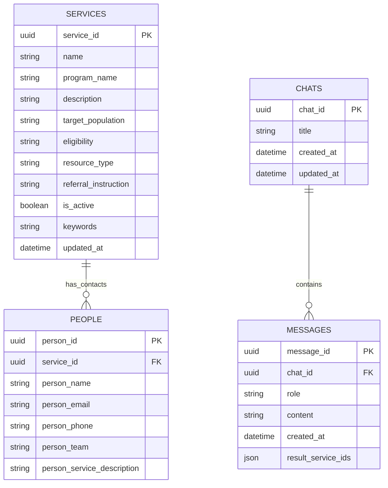

# Montrose Center Resource Discovery: Technical Design

**Status:** Proposed for review  
**Date:** October 30, 2026  
**Audience:** Montrose Center and RiceApps product and engineering teams  
**Basis:** Product Roadmap last edited October 11, 2026, and the Montrose Center repository  
**Implementation state:** Proposed Phase 1 architecture. The repository is a first-sprint scaffold.

## Summary

The first release should help Montrose Center staff describe a client need, compare specific services, and find a current contact. Staff choose a service and make the referral through existing channels. A curated, static catalog supplies the facts. The language model interprets questions and explains possible fit. The tool must identify unknown matches, eligibility facts, and contacts.

This design describes how to build Phase 1 from the first-sprint scaffold. The architecture and search diagrams show proposed behavior.

## Problem and desired outcome

Staff use personal knowledge, a group chat, and exact-keyword search to find services and contacts. Newer staff may not know the right service or search term. Staff may know a service but lack its current contact or referral instructions. These gaps can delay a referral or hide a suitable option.

The system should return a short list of **specific services** for a plain-language need. It should explain possible fit with catalog facts and state any uncertainty. When staff select a service, it should show the latest recorded contact. The goal is to reduce the time needed to find a suitable option and contact. Staff make the final choice and referral. The system does not determine eligibility or transmit client files.

## Users and key tasks

Staff may know their own program but not the full Center catalog. New staff may not know program names. Both groups need a short list of possible services, reasons for each match, important gaps, and a current contact for the selected service.

Staff enter a need and permitted context without identifying the client. They review service results, refine the search if needed, and open a service to inspect its facts and contacts. They then use an existing channel to make a referral. In Phase 1, the system does not decide eligibility, send client files, or contact clients.

## Scope and phase boundaries

| Area | Phase 1 design | Later phase |
| --- | --- | --- |
| Search | Natural-language questions and follow-ups over active internal and external services | Improve retrieval using staff feedback and, if needed, hybrid search |
| Results | Service-level recommendations with parent program, grounded reason, and uncertainty | Outcome-aware ranking after referral outcomes are available |
| Referral help | Current contact and method. Show stored instructions without promising a complete intake checklist. | Collect service-specific referral requirements in Phase 2. Add Teams sending in Phase 3. |
| Catalog | Curated, static dataset loaded by the project team | Direct browsing, admin editing, deactivation, and prompt search updates in Phase 2 |
| History | Conversation continuity for follow-up questions | Usage and referral outcome workflows after privacy and identity decisions |

The roadmap puts contact lookup in Phase 1 and complete referral requirements in Phase 2. The Phase 1 catalog may contain a short referral instruction. The tool must label incomplete guidance and must not imply it has every required client detail. Discovery does not require client-identifying information.

The earlier architecture sketch lists catalog browsing and displayed scores as possible Phase 1 extensions. This design includes conversational search and service detail. Direct browsing and admin editing come later. Staff must validate what a score means before the tool displays it.

## Staff experience

The web app should provide a chat input, message thread, and conversation list. Near the input, tell staff to omit names, birth dates, record numbers, diagnoses, clinical notes, and other identifying details. Show a brief answer followed by service cards. Each card should show the service name, scope, parent program when applicable, brief description, possible fit, and known gaps. Put contacts in the detail view so staff can check the latest record before acting.

For a question about “the second one,” use the prior answer's ordered service IDs to identify the service. Fetch its current record and show the stored contact. Ask for clarification if the reference is ambiguous. State clearly when no suitable service appears, and invite a revised search. Show “not recorded” for missing contacts or instructions.

Separate catalog facts from the model's explanation. Do not show ranking percentages or confidence scores until staff validate their meaning. Let staff inspect the record behind each recommendation.

## System design

The proposed system uses a Next.js web app, a FastAPI backend, one Supabase database, and an LLM provider. The database holds the catalog and chat history. The model interprets questions and explains retrieved results. Only the backend reads the database and calls the model. The browser never receives a Supabase secret key. The model cannot query the database or call arbitrary tools.

### System boundary

Supabase hosts the catalog and conversation tables in one database. Internal and external services are catalog records. Staff continue to send referrals through existing channels. Browsing, editing, and filtering are outside this Phase 1 design.

For each question, the API loads the conversation and prior ordered result IDs. It interprets the request, searches active services, and fetches relevant records. The model may request only `search_services` and `get_service`. The backend validates arguments, limits tool calls, and checks returned service IDs against retrieved records. It builds factual response fields from those records. Opening a service fetches its current details and contacts. The API saves the question, answer, and ordered result IDs for follow-ups.

Start with ranked full-text search over service names, keywords, and descriptions. Rank exact names highest. Apply explicit scope or population filters only when the catalog has reliable fields. The model may rewrite a query and explain results. It must preserve hard constraints. Test this search with deidentified staff questions before adding embeddings or hybrid retrieval.

### Why a relational database

Service and contact records have links that must stay consistent. One service can have several `PEOPLE` rows, and each row belongs to one service. Chats contain ordered messages. A message may also retain the ordered service IDs that staff saw. A relational database can enforce these links and support updates. It lets the backend search active services, fetch current contacts, and restore chats after refresh. Static JSON serves the first sprint but cannot provide a reliable shared catalog or durable multiuser history for the pilot.

One Supabase database is sufficient for Phase 1. Keep catalog and chat data in separate tables, accessible only through the backend. Store `program_name` on each service in the static catalog. Validate program names during import. Add a programs table later if programs need separate ownership or editing. Only the database supplies contacts, eligibility rules, and referral instructions.

### Why an agent

Staff describe needs in varied language and may refer to earlier results by position or description. A bounded agent can interpret a request, choose a catalog lookup, and explain possible fit. It maps conversation to structured search and explains retrieved facts. It does not store facts or decide referrals. An exact service-name lookup may bypass the model.

The agent can request only `search_services` and `get_service`. The API validates arguments, limits calls, and resolves references using prior service IDs. It checks returned IDs against retrieved records and fills factual fields from the database. If the model fails, the API can give a controlled fallback.

### How search works

1. The API loads the chat and ordered IDs from the last relevant answer. It resolves references such as “the second one.” If a reference is ambiguous, it asks for clarification.
2. For a new or refined need, the API identifies search terms and explicit constraints. The agent may rewrite the query but must keep hard constraints.
3. Supabase ranks **active** services by matches in `name`, `keywords`, and `description`. Exact names rank highest. Scope and population filters apply only when the catalog has reliable fields. An unknown value does not prove eligibility.
4. The backend fetches full records for candidate IDs. The agent may explain possible fit and gaps. The API checks IDs and builds service fields from retrieved records. If no suitable candidate remains, it returns a no-match state.
5. The API saves both messages and the ordered result IDs. Opening a card fetches the current service, contacts, and referral instruction again.

Search ranking helps retrieval. It does not measure confidence or eligibility. Test full-text search against deidentified staff questions before adding embeddings or hybrid retrieval. Supabase documents [ranked full-text search](https://supabase.com/docs/guides/database/full-text-search) and [hybrid search](https://supabase.com/docs/guides/ai/hybrid-search). Hybrid search is a later option if full-text search misses relevant services.

#### Resource search and referral lookup

#### Agent orchestration

The browser-held chat ID identifies a prototype conversation. It does not identify a staff member or contact. Production access must restrict chats to approved staff.

## Proposed data model

This is the same proposed schema as the [architecture diagram](architecture_diagram.md). The next-sprint JSON catalog uses these service and contact field names where applicable. The Supabase tables remain a Phase 1 proposal.

| Entity | Key fields | Purpose |
| --- | --- | --- |
| `SERVICES` | `service_id`, `name`, `program_name`, `description`, `target_population`, `eligibility`, `resource_type`, `referral_instruction`, `is_active`, `keywords`, `updated_at` | Searchable unit and source of service facts. |
| `PEOPLE` | `person_id`, `service_id`, `person_name`, `person_email`, `person_phone`, `person_team`, `person_service_description` | One referral contact record attached to one service. |
| `CHATS` | `chat_id`, `title`, `created_at`, `updated_at` | Conversation container. |
| `MESSAGES` | `message_id`, `chat_id`, `role`, `content`, `created_at`, `result_service_ids` | Conversation continuity and ordered result references. |

**PK** identifies a row. **FK** points to a row in another table. `people.service_id` links each contact to one service, and `messages.chat_id` links each message to one chat. A service can have several `PEOPLE` rows. `person_service_description` records that person's role for the service. If one stored person must serve several services later, add a join table then. `services.resource_type` is `internal` or `external`. `messages.role` is `user` or `assistant`; assistant messages may hold an ordered JSON list of `result_service_ids` for follow-ups. The design omits `Program_ID` because there is no programs table and defers `Chat History.Person_ID` until staff identity is designed.

The proposed schema stores `program_name` on each service. This suits the static Phase 1 catalog, but names may drift, so validate them during import. `program_name`, `target_population`, `eligibility`, and `referral_instruction` may be null. `resource_type` does not establish eligibility. External services may have no Montrose parent program. Exclude inactive services from new searches. Historical messages can retain the text staff saw.

The first-sprint JSON has only two fictional records. It does not populate the proposed schema. Before a pilot, Montrose Center must approve a catalog with service descriptions, `resource_type`, population, eligibility status, current contacts, and a maintainer for each record. The import should reject incomplete IDs and flag missing contacts for review.

## API contract and implementation path

The scaffold defines chat models and method signatures. It covers creating, listing, reading, and renaming chats, plus sending messages. The router has no registered chat endpoints. Service, repository, and agent methods remain TODOs. The first sprint should implement them with fictional data, saved conversations, and a clear no-answer case.

For Phase 1, add structured recommendations to `SendMessageResponse`. Each recommendation should include a service ID, name, `resource_type`, parent program, reason, and gaps. A detail endpoint should return current catalog fields and contacts, with `updated_at` when available. The API should distinguish no match, missing contact, ambiguous reference, invalid input, and model failure. Retrieval failure must never produce an invented recommendation.

Use the scaffolded chat endpoints, plus `GET /services?q={text}` for active-service search and `GET /services/{service_id}` for current details. The [API contract](api-contract.md) specifies proposed JSON bodies, status codes, and error behavior. Catalog browsing without a query and admin write endpoints remain outside Phase 1.

## Quality and rollout

Test with a small set of deidentified questions from staff across programs. Include known names, staff descriptions, internal and external requests, constraints, follow-ups, no-match cases, and missing contacts. Check service relevance, factual explanations, and contact accuracy. Compare response and task times with the current search and group-chat process. Set release thresholds with Montrose Center after recording a baseline. The roadmap gives no targets or latency budget yet.

Start with a fictional-data sprint demo. Then run a limited staff pilot with an approved catalog. Service owners should check sample records and contacts first. Staff need a defined channel to report corrections. During Phase 1, a project maintainer updates the static catalog and republishes search data. Use pilot findings to choose Phase 2 editing and referral-checklist features.

### Phase 1 acceptance checks

- A staff member can ask a question in ordinary language, receive service-level results from active catalog records, and refine the request in the same conversation.
- A follow-up that names or references a prior result resolves to the correct service, or asks for clarification when the reference is ambiguous.
- Every shown service fact and contact matches a stored record. Opening a card refreshes its details. The tool labels missing facts and invents no results for a no-match query.
- A chat can be reopened after a refresh in the approved pilot access model. Unauthorized access to another staff member's history is denied.
- The team reviews deidentified questions with Montrose Center staff. It compares relevance, factual accuracy, task time, response time, and model cost with agreed release thresholds.

## Risks and decisions for review

1. **Catalog accuracy.** Search quality cannot exceed the service data. Decide who approves initial records, how often contacts are checked, and how staff report stale details.
2. **Referral meaning.** The roadmap defines a referral as handing a client file to another staff member. Decide whether the product should later connect clients directly to a resource. That choice changes workflow and privacy requirements.
3. **Identity and retention.** Decide how staff sign in, who may view saved chats, and how long nonidentifying conversations are kept before a real pilot.
4. **Success criteria.** Agree on what makes a good match, what task-time improvement matters, and an acceptable response time and model cost.
5. **Phase 1 guidance.** Confirm the minimum contact fields and whether a brief referral instruction is useful in the first release despite the complete requirements workflow being Phase 2.
6. **Later priorities.** Revisit the relative value of referral outcomes, Teams integration, a broader knowledge repository, and a public client tool after Phase 1 feedback.

## Repository references

This design draws on the README, the sprint plan, the architecture and search diagrams, and the current app scaffold. The Word version includes the diagrams above. The product team's roadmap supplies delivery phases, intended outcomes, and open questions.
