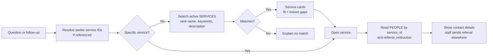
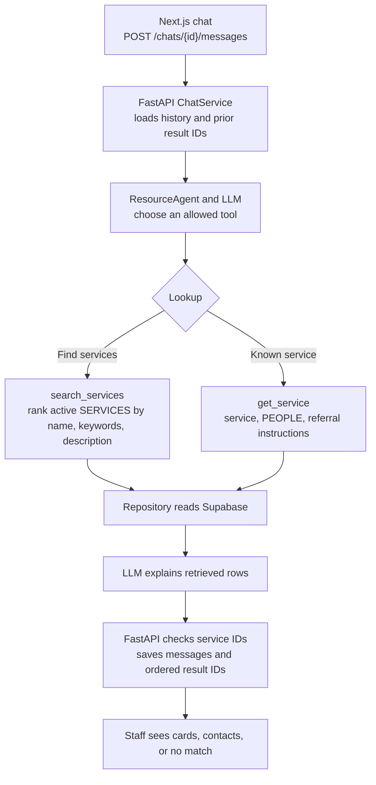

# Phase 1 search and agent flows

These diagrams show **proposed Phase 1 behavior**. The repository still has agent and chat stubs and a fictional JSON catalog. The [architecture diagram](architecture_diagram.md) shows the system boundary and proposed Supabase tables.

## 1. Resource search and referral lookup

Start with ranked full-text search over `services.name`, `services.keywords`, and `services.description`. Search only records with `is_active = true`. Rank exact names highest. Apply explicit constraints only when the catalog has reliable fields. Test with real staff questions before adding semantic or hybrid search. Supabase documents [full-text ranking](https://supabase.com/docs/guides/database/full-text-search) and [hybrid search](https://supabase.com/docs/guides/ai/hybrid-search).

The model may generate explanations. Service fields and contact details must come from database rows. A detail lookup reads matching `PEOPLE` rows and the latest `SERVICES.referral_instruction`. Label missing contacts or instructions clearly. The tool does not send referrals.

## 2. Agent search flow

FastAPI loads the conversation before calling the agent. The agent offers two **allowed backend tools**: `search_services` and `get_service`. The first searches a need or name. The second gets a selected or previously shown service. Both read Supabase through a repository. The LLM has no database credentials. The backend validates arguments, limits calls, and checks returned IDs against retrieved rows. It builds cards and contact answers from those rows, then saves the exchange. A known-service lookup may skip the LLM.

For “who handles referrals for the second one?”, the backend needs the **ordered service IDs from the earlier answer**. Assistant prose alone cannot identify the second result reliably. Add `messages.result_service_ids` to the proposed chat schema. The browser-held chat ID identifies a prototype conversation. It does not identify staff or link to `PEOPLE`.
