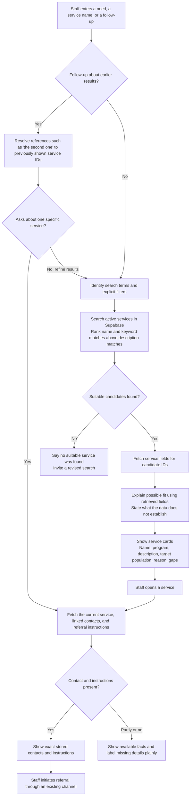
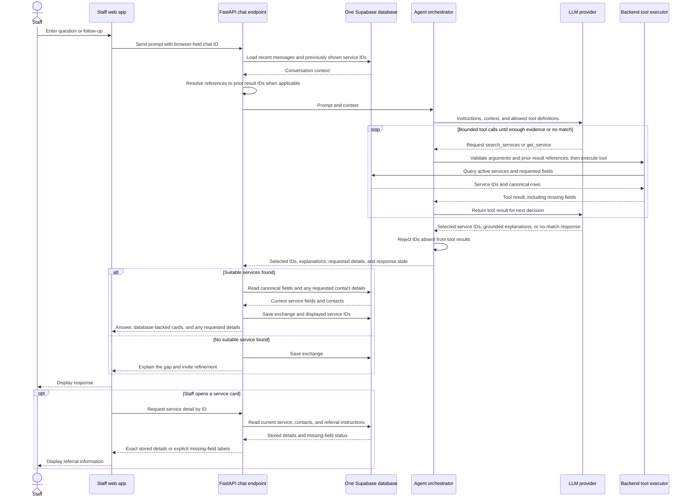

# Phase 1 search and agent flows

These diagrams describe the **intended Phase 1 behavior**, not the current first-sprint implementation. The repository still has agent and chat method stubs and a fictional JSON catalog. The [architecture diagram](architecture_diagram.md) shows the overall system boundary and proposed Supabase tables.

## 1. Resource search and referral lookup

The initial retrieval method is ranked full-text search over `services.name`, `services.keywords`, and `services.description`, with active services only. A known name should receive strong priority. Explicit constraints, such as an age group or internal versus external scope, should narrow results only when the catalog supports them. Compare results with real staff questions before adding semantic or hybrid search; [Supabase full-text search](https://supabase.com/docs/guides/database/full-text-search) supports ranking, while [hybrid search](https://supabase.com/docs/guides/ai/hybrid-search) adds embeddings and a second retrieval path.

The explanation may be generated, but the card's service fields, contact details, and referral instructions come from database rows. Opening a card fetches the latest detail rather than trusting an earlier chat answer. The tool does not send referrals.

## 2. Agent orchestration and tool calls

The agent can choose among **allowlisted backend tools**; it does not connect directly to Supabase. `search_services` handles a need, a known name, or a refined query. `get_service` retrieves a specific service when a follow-up refers to a prior result. The backend validates tool arguments and checks references to earlier results. It builds service cards and contact answers from database records, so the LLM's job is to interpret the request, choose a tool, and explain why retrieved services may fit. It cannot invent a contact or referral instruction. A simple known-service lookup can skip the LLM when no interpretation is needed.

For follow-ups such as “who handles referrals for the second one?”, the backend needs the **ordered service IDs shown in the earlier answer**, not just the assistant's prose. Persisting those IDs with the assistant response is a proposed extension to the current chat schema. The browser-held chat ID identifies the prototype conversation; it is not a staff identity or a link to the referral-contact table.
