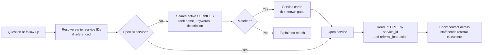

# Phase 1 search and agent flows

These diagrams describe the **intended Phase 1 behavior**, not the current first-sprint implementation. The repository still has agent and chat method stubs and a fictional JSON catalog. The [architecture diagram](architecture_diagram.md) shows the overall system boundary and proposed Supabase tables.

## 1. Resource search and referral lookup



The initial retrieval method is ranked full-text search over `services.name`, `services.keywords`, and `services.description`, with `is_active = true`. A known name should receive strong priority. Explicit constraints should narrow results only when the catalog has reliable fields for them. Compare results with real staff questions before adding semantic or hybrid search; [Supabase full-text search](https://supabase.com/docs/guides/database/full-text-search) supports ranking, while [hybrid search](https://supabase.com/docs/guides/ai/hybrid-search) adds embeddings and a second retrieval path.

The explanation may be generated, but each card's service fields and each person's contact details come from database rows. A detail lookup reads `PEOPLE` rows whose `service_id` matches the selected service and the latest `SERVICES.referral_instruction`. Missing contacts or instructions are labeled plainly. The tool does not send referrals.

## 2. Agent orchestration and tool calls

```mermaid
sequenceDiagram
    participant UI as Next.js chat
    participant API as FastAPI chat service
    participant Agent as Resource agent
    participant LLM as LLM provider
    participant Repo as Repositories
    participant DB as Supabase

    UI->>API: POST /chats/{id}/messages
    API->>Repo: Load messages and earlier result_service_ids
    Repo->>DB: Read chat history
    DB-->>Repo: Saved messages
    Repo-->>API: History + earlier result IDs
    API->>Agent: User text + conversation context
    Agent->>LLM: Prompt + allowed tool definitions
    LLM-->>Agent: search_services(query) or get_service(id)
    Agent->>Agent: Validate tool arguments and service IDs
    Agent->>Repo: Search or get service
    Repo->>DB: Search active SERVICES; load PEOPLE for detail
    DB-->>Repo: Matching rows
    Repo-->>Agent: Retrieved rows
    Agent->>LLM: Retrieved facts
    LLM-->>Agent: Explanation + service IDs
    Agent-->>API: Answer + retrieved service IDs
    API->>API: Verify IDs; build cards from stored rows
    API->>Repo: Save messages + ordered result_service_ids
    Repo->>DB: Write chat exchange
    DB-->>Repo: Saved rows
    Repo-->>API: Saved exchange
    API-->>UI: Answer + service cards
```

The resource agent exposes two **allowlisted backend tools** to the LLM: `search_services` for a need or known name, and `get_service` for a selected or previously shown service. The agent calls the service repository to reach Supabase; the LLM has no database credentials. The backend validates tool arguments, limits the number of tool calls, and checks returned service IDs against retrieved rows. It builds service cards and contact answers from those rows. A simple known-service lookup can skip the LLM when no interpretation is needed.

For follow-ups such as “who handles referrals for the second one?”, the backend needs the **ordered service IDs shown in the earlier answer**, not just the assistant's prose. `messages.result_service_ids` is a proposed addition to the current chat schema for this purpose. The browser-held chat ID identifies the prototype conversation; it is not a staff identity or a link to `PEOPLE`.
