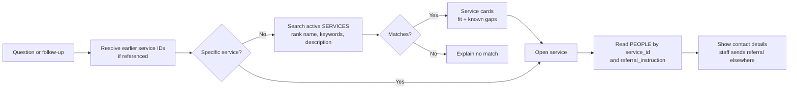
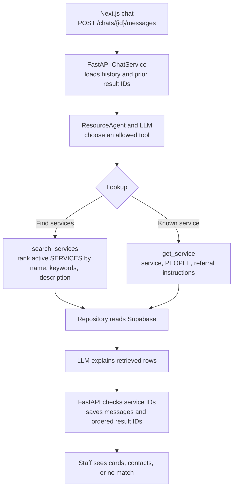

# Phase 1 search and agent flows

These diagrams describe the **intended Phase 1 behavior**, not the current first-sprint implementation. The repository still has agent and chat method stubs and a fictional JSON catalog. The [architecture diagram](architecture_diagram.md) shows the overall system boundary and proposed Supabase tables.

## 1. Resource search and referral lookup

The initial retrieval method is ranked full-text search over `services.name`, `services.keywords`, and `services.description`, with `is_active = true`. A known name should receive strong priority. Explicit constraints should narrow results only when the catalog has reliable fields for them. Compare results with real staff questions before adding semantic or hybrid search; [Supabase full-text search](https://supabase.com/docs/guides/database/full-text-search) supports ranking, while [hybrid search](https://supabase.com/docs/guides/ai/hybrid-search) adds embeddings and a second retrieval path.

The explanation may be generated, but each card's service fields and each person's contact details come from database rows. A detail lookup reads `PEOPLE` rows whose `service_id` matches the selected service and the latest `SERVICES.referral_instruction`. Missing contacts or instructions are labeled plainly. The tool does not send referrals.

## 2. Agent search flow

FastAPI loads the conversation before calling the resource agent. The agent exposes two **allowlisted backend tools** to the LLM: `search_services` for a need or known name, and `get_service` for a selected or previously shown service. Those tools call a repository to read Supabase; the LLM has no database credentials. The backend validates tool arguments, limits the number of tool calls, and checks returned service IDs against retrieved rows. It builds service cards and contact answers from those rows, then saves the exchange. A simple known-service lookup can skip the LLM when no interpretation is needed.

For follow-ups such as “who handles referrals for the second one?”, the backend needs the **ordered service IDs shown in the earlier answer**, not just the assistant's prose. `messages.result_service_ids` is a proposed addition to the current chat schema for this purpose. The browser-held chat ID identifies the prototype conversation; it is not a staff identity or a link to `PEOPLE`.
